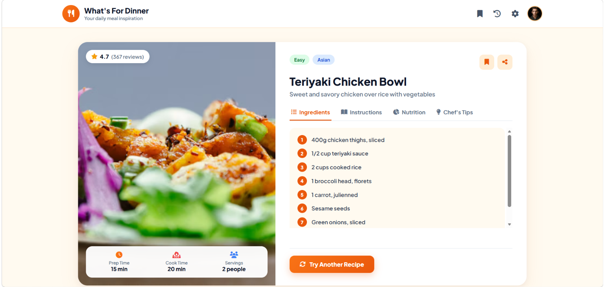
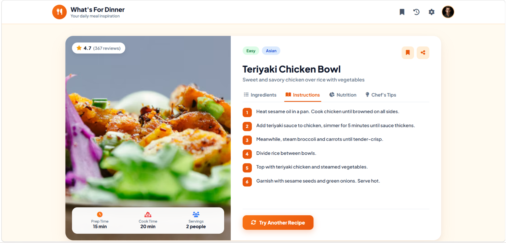
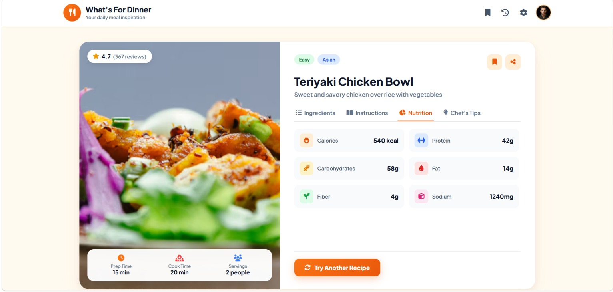
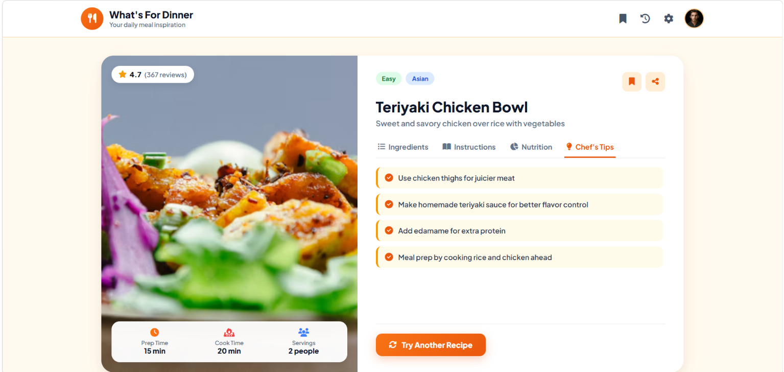
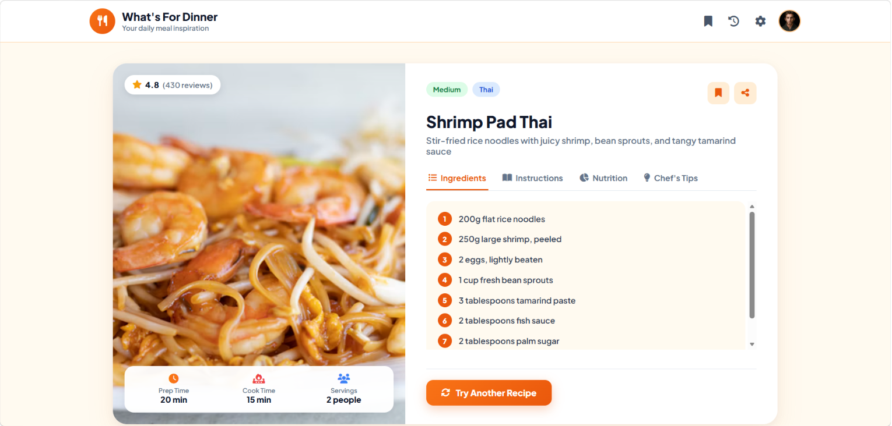
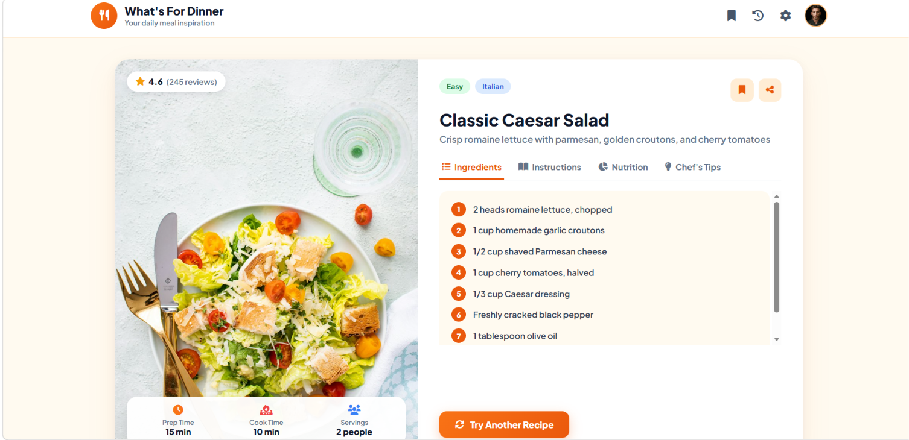

# 🍽️ What's For Dinner | Recipe Inspiration Website

A responsive and interactive recipe inspiration website built with HTML, CSS, and JavaScript.

What's For Dinner helps users discover delicious meal ideas and explore ingredients, step-by-step cooking instructions, nutritional information, and useful cooking tips.

## 🌐 Live Demo

**[View Live Website](https://sandy-mohamed.github.io/Whats-For-Dinner/)**

## 📸 Screenshots

### Recipe Ingredients

### Cooking Instructions

### Nutrition Facts

### Chef's Tips

### Shrimp Pad Thai

### Classic Caesar Salad

## ✨ Features

- 🍲 Explore 8 different recipes with food photography
- 🎲 Discover random meals using the "Try Another Recipe" button
- 🥗 View detailed ingredient lists
- 👩‍🍳 Follow step-by-step cooking instructions
- 📊 Explore nutritional information, including calories, protein, carbohydrates, and fat
- ⏱️ View preparation time, cooking time, and servings
- ⭐ Display recipe ratings and difficulty levels
- 💡 Discover helpful cooking tips
- 📑 Interactive tabs for organizing recipe information
- 📱 Responsive and user-friendly interface

## 🛠️ Technologies Used

- **HTML5** — Semantic page structure
- **CSS3** — Custom styling and responsive design
- **JavaScript (ES6+)** — Dynamic recipe rendering and interactivity
- **Font Awesome** — Icons
- **Google Fonts** — Typography

## 📁 Project Structure

- `index.html` — Main website structure
- `css/style.css` — Website styling
- `js/main.js` — Recipe data and interactive functionality
- `images/` — Recipe images and visual assets

## ⚙️ How It Works

The application stores eight recipe objects in JavaScript and dynamically displays their details.

Users can generate another recipe using the random recipe button and switch between tabs to explore ingredients, instructions, nutrition facts, and cooking tips.

The project uses local JavaScript data and does not require a backend or external recipe API.

## 🚀 Getting Started

1. Clone or download this repository.
2. Open the project folder.
3. Launch `index.html` in your browser.
4. Explore recipes and discover new meal ideas!

## 👩‍💻 Developer

**Sandy Mohamed**

Front-End Developer

[GitHub Profile](https://github.com/sandy-mohamed)
